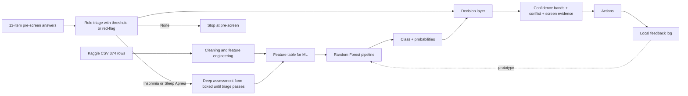
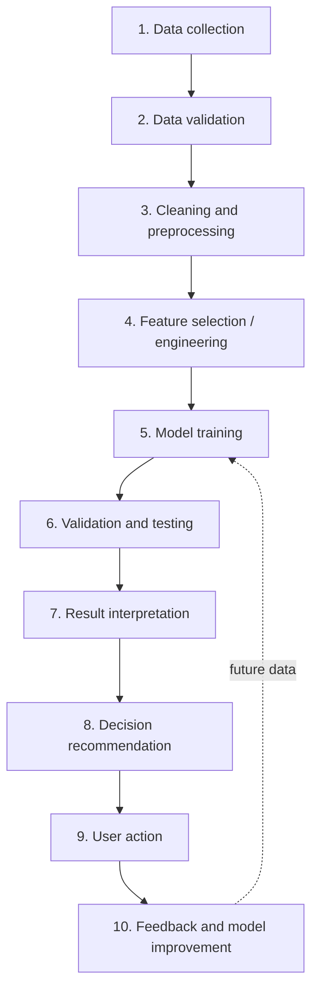

# Report Supporting Content (English)

Use this pack inside the 10–15 page PDF report required by Project Guidance 1501418.  
Group nicknames: Frame (เฟรม), Dos (ดอส), Doi (ด๋อย), Ben (เบน), Boss (บอส).

Numbers below come from the local project files and stratified 5-fold cross-validation run on 8 November 2026.

---

## 1. Dataset information table (Guidance 4.2)

| Dataset item | Project information |
| --- | --- |
| Dataset name | Sleep Health and Lifestyle Dataset |
| Dataset provider or owner | Laksika Tharmalingam (`uom190346a`) |
| Dataset source or URL | https://www.kaggle.com/datasets/uom190346a/sleep-health-and-lifestyle-dataset |
| Data-collection period | Not stated by the publisher; dataset page last updated about 3 years before this project (publisher note: synthetic data created for illustration) |
| Number of records | 374 rows in the project CSV (`Sleep_health_and_lifestyle_dataset.csv`) |
| Number of attributes | 13 columns in the file; blood pressure is kept in the CSV but excluded from the model so deep inputs align with general smart-watch metrics |
| Data format | CSV (UTF-8) |
| Target variable | `Sleep Disorder` with classes `None`, `Insomnia`, `Sleep Apnea` |
| License or usage conditions | Confirm on the Kaggle page at submission time. The author states the data are **synthetic and created for illustration**. A related Figshare deposit by the same author uses **CC BY 4.0**; do not claim a license that is not shown on the Kaggle page. |
| Date accessed | **[Fill exact download date]** — documentation pack prepared 8 November 2026 |
| Local project path | `D:\Coding\SelectedTopic\Sleep_health_and_lifestyle_dataset.csv` |
| Relevance to the decision | Supports classification of sleep-disorder risk from demographic, lifestyle, and cardiovascular fields for a clinician / wellness screening decision |

### Short relevance paragraph (Guidance 4.3)

The dataset is suitable because it contains the same decision labels the prototype must support (`None`, `Insomnia`, `Sleep Apnea`) and the lifestyle and cardiovascular inputs used in screening conversations. It is complete enough for a course prototype (374 usable rows after preprocessing, 0 rows dropped). It does **not** fully represent a clinical population: ages are limited to about 27–59, occupations are skewed, many feature rows are duplicated, and the publisher describes the data as synthetic. The prototype therefore demonstrates decision support, not clinical diagnosis.

Full attribute roles are documented in `docs/data-dictionary.md` (Guidance 4.4).

---

## 2. Data model (Guidance 4.7)

### Feature / entity view

```text
[Source CSV]
  Person (Person ID)
    - Gender, Age, Occupation
    - Sleep Duration, Quality of Sleep
    - Physical Activity Level, Stress Level, Daily Steps
    - BMI Category
    - Blood Pressure (text)  -->  excluded from model (not a general smart-watch metric)
    - Heart Rate
    - Sleep Disorder (target)

[Pre-screen layer | rules]
  13 yes/no symptom items
    --> triage class: None | Insomnia | Sleep Apnea

[Deep-assessment layer | ML]
  Input features --> Random Forest pipeline
    --> predicted class + probabilities
    --> risk level + recommended actions
```

### Mermaid data-flow diagram (paste into report / slides)



### Transformations recorded in code

| Step | Transformation |
| --- | --- |
| Import | Keep literal `None` labels (`keep_default_na=False`); map blank / nan-like target text to `None` |
| BMI | Map `Normal Weight` → `Normal` (21 rows) |
| Blood pressure | Present in CSV but excluded from features (smart-watch alignment) |
| Encoding | One-hot for `Gender`, `Occupation`, `BMI Category`; scale numeric features |
| Demo form | Weight + height → WHO BMI category before scoring |

---

## 3. Ten-step workflow including feedback (Guidance 5.3)



| Step | What this project does |
| --- | --- |
| 1. Data collection | Use the public Kaggle CSV; collect demo inputs from the local web form and pre-screen |
| 2. Data validation | Check required fields, blood-pressure order, weight/height ranges, complete pre-screen answers |
| 3. Cleaning and preprocessing | Relabel BMI, drop blood pressure from features, preserve `None`, encode and scale features |
| 4. Feature selection / engineering | Fixed feature set in `model.py` for RF; pre-screen answers stay outside the forest and enter the decision layer |
| 5. Model training | `RandomForestClassifier` (`n_estimators=300`, `min_samples_leaf=2`, `class_weight=balanced`, `random_state=42`) |
| 6. Validation and testing | Stratified 5-fold CV on all 374 rows; report accuracy and macro precision / recall / F1 |
| 7. Result interpretation | Show class probabilities, feature importance, pre-screen vs model, hybrid score |
| 8. Decision recommendation | Confidence bands + conflict rules + screen-evidence boost → Low / Medium / High actions |
| 9. User action | Keep routine, adjust habits, or seek clinical review; clinician remains final decision maker |
| 10. Feedback and improvement | **Prototype now:** useful / not useful + note on `#result`, mirrored to browser `localStorage` and local server file `data/feedback.jsonl` via `/api/feedback`. Usefulness rate supports the ≥80% criterion. **Not yet:** clinic database or automatic retraining |

### Hybrid decision path in the running demo

1. Rule-based pre-screen (threshold or red-flag) → `None` / `Insomnia` / `Sleep Apnea`
2. Deep form opens only if Insomnia or Sleep Apnea is flagged
3. Random Forest scores lifestyle / heart features only
4. Decision layer merges model probability, confidence band, conflict check, and screen evidence
5. User can log local feedback for the usefulness criterion

### Pre-screen flagging rules

| Class | Flag rule |
| --- | --- |
| Insomnia | At least 2 yes answers among items 1, 6, 9 |
| Sleep Apnea | At least 2 yes answers in the apnea item set, **or** yes on red-flag item 3, 4, or 12 |
| None | Neither group flagged |

### Confidence bands and conflict rules (Guidance 5.6 style)

| Condition | Decision effect |
| --- | --- |
| Top class probability &lt; 0.40 | Uncertain pathway; escalate monitoring / caution |
| Probability 0.40–0.69 | Moderate confidence; class-based action with caution |
| Probability ≥ 0.70 | High confidence; full class action |
| Pre-screen disorder + model `None` | Forced clinical review (High) |
| Pre-screen top group ≠ model class | Forced clinical review (High) |
| Stages agree and screen evidence is strong / red-flag | May raise Medium → High |

**Honest limit:** pre-screen answers are **not** trained into Random Forest weights, because the CSV has no labels for those 13 items. They adjust the **decision layer** and are shown on the result page.

---

## 4. Why Random Forest + baseline + success criteria (Guidance 5.1, 5.4, 5.5)

### Why Random Forest for this decision

- The task is **multiclass classification** with mixed categorical and numeric inputs.
- Tree ensembles handle nonlinear interactions (for example BMI band with blood pressure) without heavy manual feature crossing.
- `class_weight="balanced"` helps with imbalance (`None` 219, `Sleep Apnea` 78, `Insomnia` 77).
- Feature importances support explainability on the result page.
- A single strong baseline is not enough for the report: Random Forest is preferred here over a lone decision tree because bagging reduces variance on a small, partly duplicated table.

### Baseline comparison (same preprocessing, stratified 5-fold, `random_state=42`)

| Model | Accuracy | Macro Precision | Macro Recall | Macro F1 |
| --- | ---: | ---: | ---: | ---: |
| Logistic Regression (balanced) | 0.904 ± 0.039 | 0.885 ± 0.049 | 0.887 ± 0.048 | 0.884 ± 0.048 |
| Decision Tree (balanced, `min_samples_leaf=2`) | 0.866 ± 0.042 | 0.834 ± 0.047 | 0.862 ± 0.047 | 0.845 ± 0.047 |
| **Random Forest (project model)** | **0.909 ± 0.035** | **0.888 ± 0.043** | **0.884 ± 0.048** | **0.885 ± 0.045** |

Interpretation for the report: Random Forest is slightly better than logistic regression on accuracy and matches it closely on macro F1, while clearly beating a single decision tree. Because 265 feature rows are duplicates, all three scores may look optimistic for new people.

### Measurable success criteria (write these into the report)

Technical criterion:

- The selected model is successful if stratified 5-fold **macro F1 ≥ 0.80** and **accuracy ≥ 0.85** on the project table.
- Current Random Forest result: macro F1 **0.885**, accuracy **0.909** → **meets the technical criterion**.

Decision-support criterion:

- At least **80%** of local feedback entries mark the recommendation as useful for choosing the next action.
- **How to measure in the demo:** open `#result` after an assessment and use the Feedback panel; the page shows `useful/total` from `localStorage`.
- **Status:** fill the final percentage from rehearsal feedback before submission.

---

## 5. Data quality, bias, ethics, and risks (Guidance 4.5 and 5.8)

### Data quality findings and handling

| Issue | Finding | Handling in this project |
| --- | --- | --- |
| Missing values | Target blanks would be misread as NA by pandas | Import with `keep_default_na=False`; map empty target text to class `None` |
| Duplicates | 265 duplicate feature rows (same inputs, Person ID ignored) | Keep rows for training; warn on the Explore page that CV may look too high |
| Inconsistent labels | `Normal Weight` vs `Normal` | Relabel 21 rows to `Normal` |
| Incorrect formats | Blood pressure stored as text `120/80` | Split into numeric systolic / diastolic |
| Outliers / range | Demo form allows values outside training ranges | Still score, but show an out-of-range note |
| Class imbalance | `None` is the majority class | Use `class_weight="balanced"` |
| Sensitive data | No names or contact data in the CSV; demo runs locally | Do not upload private patient data; keep the demo on localhost for the course |
| Bias | Occupation and age bands are narrow; synthetic publisher note | State that results are not population-representative |

### Benefits

- Faster first-pass screening before a deeper form
- Consistent class-to-action mapping for course demonstration
- Transparent probabilities and important factors for discussion with a clinician or wellness staff

### Limitations

- Synthetic / illustrative source data
- Small sample and duplicated rows
- Pre-screen rules are not a validated clinical questionnaire score
- Pre-screen items are not RF training features; only the decision layer uses them
- Feedback is browser-local, not a clinic outcomes database
- Model classes exclude other sleep disorders

### Ethics and risks

- Incorrect predictions may cause false reassurance or unnecessary worry → require human oversight
- Prototype is a **screening aid**, not a diagnosis
- Privacy: keep personal demo entries local; do not commit real patient data
- Fairness: occupational skew may change predictions for underrepresented jobs (`Other` is unseen)
- Explainability is partial (importances and comparisons, not full causal proof)

---

## 6. Individual contribution statement (Guidance checklist)

Edit percentages if your real workload differs. Total should remain 100%.

| Member | Main responsibilities | Approx. share |
| --- | --- | --- |
| **เฟรม (Frame)** | Overall prototype direction; two-stage pre-screen + deep assessment flow; decision rules / actions; live demo lead; integration of report technical sections | 24% |
| **ดอส (Dos)** | Problem background and justification; stakeholders and decision requirements; benefits / limitations / ethics narrative; closing slides | 19% |
| **ด๋อย (Doi)** | Dataset citation table; data dictionary alignment; data-quality and preprocessing write-up; source/license verification | 19% |
| **เบน (Ben)** | EDA charts and interpretation; data-model diagram; linking visualizations to the decision problem | 19% |
| **บอส (Boss)** | Model choice justification; baseline comparison; evaluation metrics and success criteria; workflow / architecture diagrams | 19% |

Shared items for every member:

- Can explain the dataset, data model, Random Forest path, and decision actions
- Reviews AI-assisted text before submission
- Participates in the 15-minute presentation and Q&A

---

## 7. Decision rules used in the prototype (Guidance 5.6)

### Pre-screen → gate

| Triage class | Rule | Next action |
| --- | --- | --- |
| None | Threshold / red-flag not met | Stop; deep assess locked |
| Insomnia | ≥2 of items 1, 6, 9 | Unlock deep assessment |
| Sleep Apnea | ≥2 apnea items, or red-flag 3 / 4 / 12 | Unlock deep assessment |

### Model output + decision layer → action

| Signal | Risk pathway | Recommended action family |
| --- | --- | --- |
| Clear None, confidence ≥ 0.40, no conflict | Low | Keep the current routine |
| Insomnia pathway without conflict | Medium or High if screen evidence strong | Adjust sleep habits; escalate if uncertain/conflict |
| Sleep Apnea pathway or apnea red-flag boost | High | Clinician review / sleep study discussion |
| Conflict between pre-screen and model | High | Forced clinical review; do not trust the convenient label |
| Confidence &lt; 0.40 | Medium/High caution | Increase monitoring; do not treat as clear clearance |

Human approval: a clinician confirms any medical decision. The demo stores optional usefulness feedback in localStorage for step 10 of the workflow.
